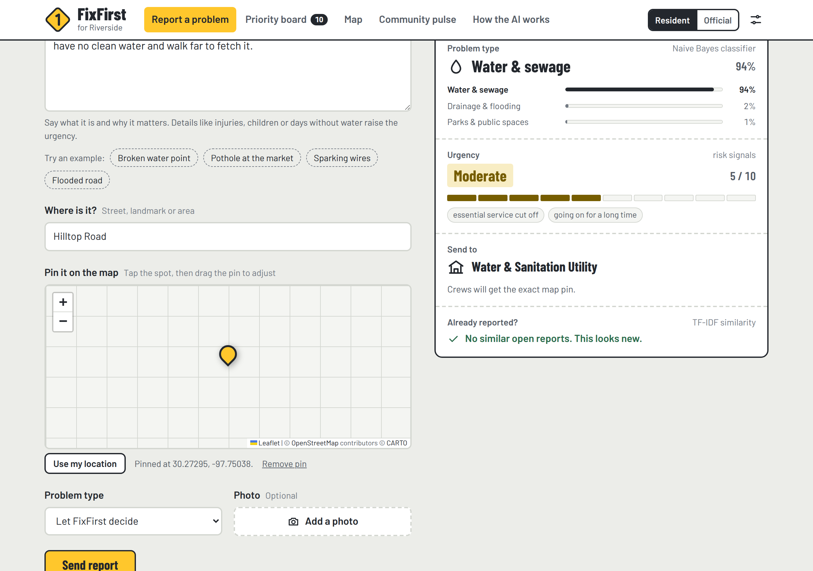
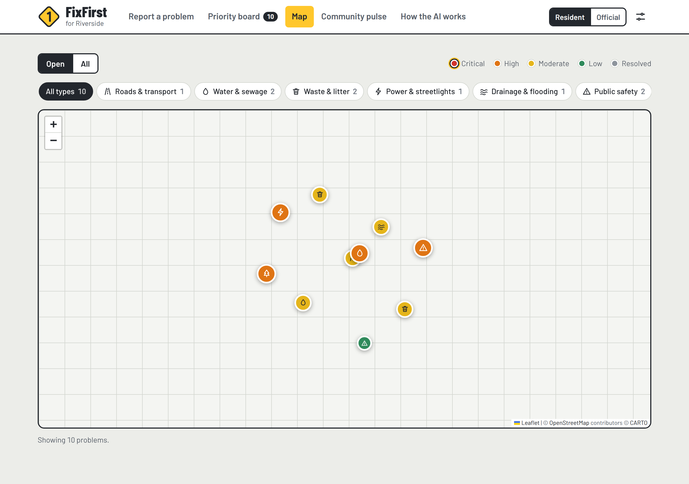
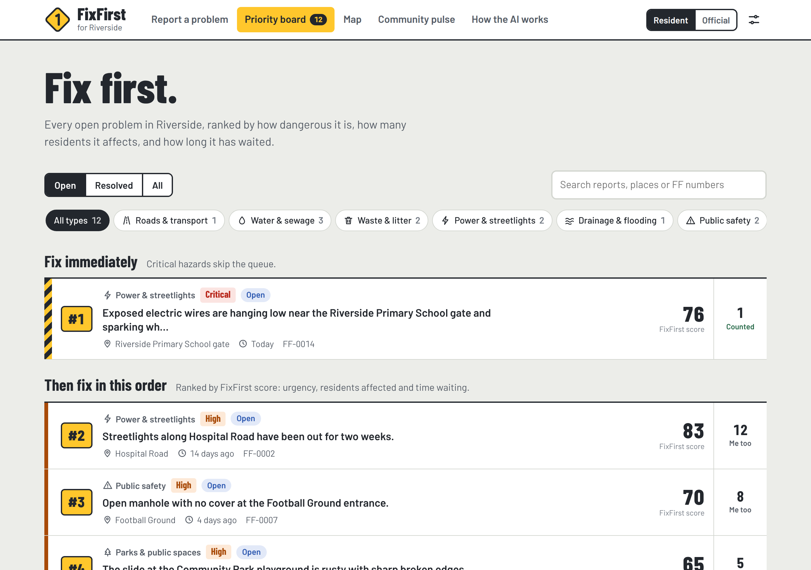

# FixFirst

**Residents pin a community problem on the map and describe it in plain words. FixFirst's in-browser AI works out what kind of problem it is, scores how dangerous it is, catches duplicate reports nearby, routes it to the right office and ranks what should be fixed first.**

Built for **WarriorHacks 2.0**, theme: *create a project that solves an issue in your community, county, state, or nation.*

**Live demo:** https://YOUR-USERNAME.github.io/fixfirst/ &nbsp;|&nbsp; **Demo video:** ADD-LINK-HERE



## The problem

Broken water points, uncollected garbage, potholes, failed streetlights and open manholes usually get reported through scattered phone calls, social media posts and word of mouth. Local offices receive vague, duplicated complaints with no exact location, so crews can't find the spot and a live wire next to a school can sit in the same pile as overgrown grass in a park. Residents rarely hear back, so they stop reporting, and the most dangerous problems stay unfixed the longest.

## What FixFirst does

- **Pin it and describe it.** A resident taps the spot on the map (or uses their phone's location) and describes the problem in their own words. A live *work order* fills itself in while they type.
- **Sorts it automatically** into one of 7 problem types: water & sewage, waste & litter, roads & transport, power & streetlights, drainage & flooding, public safety, and parks. It shows a confidence score and names the office that should fix it.
- **Scores urgency from 0 to 10** using explainable risk signals such as no clean water, exposed wires, injuries or children nearby. Every point is shown to the user.
- **Catches duplicates nearby.** If a neighbor already reported the same pothole 17 m away, the resident taps *count me too* instead of filing a new report, so one problem with 15 voices outranks 15 scattered complaints.
- **Problem map.** Every open problem appears as a pin, colored by urgency and filterable by type.
- **Ranks the work.** The priority board orders every open problem by a transparent FixFirst score. Critical hazards are pinned to the top.
- **Drafts a letter to the office** with the evidence: residents affected, urgency, days waiting and an exact map link.
- **Officials update status and correct the AI.** Each correction is added to the training data and the model retrains instantly.
- **Community pulse** shows hotspots, open problems by type and the problem that has waited longest.
- Works on phones, in light and dark mode, with no account, no server and no API key.

| Problem map | Priority board |
|---|---|
|  |  |

## How the AI works

All of the machine learning is written from scratch in [`js/classifier.js`](js/classifier.js), with no ML libraries:

| Step | Technique |
|---|---|
| Clean the text | tokenizer, stop-word removal, suffix-stripping stemmer, word pairs (bigrams) |
| Problem type | multinomial **Naive Bayes** with Laplace smoothing, trained on 238 labelled community reports in [`js/data.js`](js/data.js) |
| Urgency | weighted risk signals, capped at 10, mapped to Low / Moderate / High / Critical |
| Duplicates | **TF-IDF** vectors and **cosine similarity** for *what* the problem is, plus **haversine distance** between map pins for *where* it is (place names are used when there's no pin) |
| Ranking | FixFirst score = 7 × urgency (max 70) + min(20, 6 × log2(1 + residents)) + min(10, 0.5 × days waiting). Critical hazards always rank first. |
| Learning | corrections from officials join the training set and the model retrains in the browser |

**Accuracy: 86.6%** leave-one-out accuracy across the 7 problem types (each training sentence is hidden in turn, the model retrains without it, then guesses its type). Reproduce it with `node tests/evaluate.js`.

## Try it

Open the live demo, or run it locally (no build step, no install):

```bash
git clone https://github.com/YOUR-USERNAME/fixfirst.git
cd fixfirst
# then open index.html in any browser
```

Run the model checks (Node.js 18 or newer, no packages needed):

```bash
node tests/evaluate.js
```

**Quick demo path:** click the *Broken water point* example; the pin drops on the map and the work order routes it to the Water & Sanitation Utility. Press **Send report**, then open the **Map** tab. Try *Pothole at the market* to see a duplicate caught 17 m away, and *Sparking wires* to see a critical hazard jump to the top. Switch to **Official** (top right) to update a status, correct a problem type, or draft a letter.

## Make it yours

At the top of [`js/data.js`](js/data.js), set `COMMUNITY` to your community's name and map location (latitude and longitude, copied from Google Maps or openstreetmap.org). The demo reports are placed around that point. You can also rename the offices, add training sentences written the way people in your community talk, and replace the demo reports with real places.

## Project structure

```
index.html          page structure
css/style.css       design: light and dark themes, responsive down to phones
css/leaflet.css     map library styles
js/data.js          community settings, problem types, offices, training sentences, urgency signals, demo reports
js/classifier.js    the ML: tokenizer, Naive Bayes, urgency scorer, TF-IDF + distance duplicates, priority score
js/app.js           interface logic, including the maps
tests/evaluate.js   accuracy and behaviour checks (Node.js)
screenshots/        images used in this README and the submission
```

## Limitations and next steps

- Reports are stored in each browser (localStorage) so the prototype runs anywhere with zero setup. Next step: a shared database such as Firebase or Supabase, plus sign-in for officials.
- SMS and WhatsApp reporting, so residents without smartphones or data can take part.
- Training data in local languages, and real complaint records from local offices to improve accuracy.
- Classifying the attached photos too, and clustering nearby reports into hotspots on the map.

## Built with

HTML, CSS and vanilla JavaScript. Maps: [Leaflet](https://leafletjs.com) with map data © [OpenStreetMap](https://www.openstreetmap.org/copyright) contributors and tiles by [CARTO](https://carto.com/attributions). Fonts: Barlow and Barlow Condensed (Google Fonts). No frameworks and no external AI API.

## Team

- YOUR NAME: design, development, ML

## License

MIT, see [LICENSE](LICENSE). Leaflet is BSD 2-Clause licensed.
